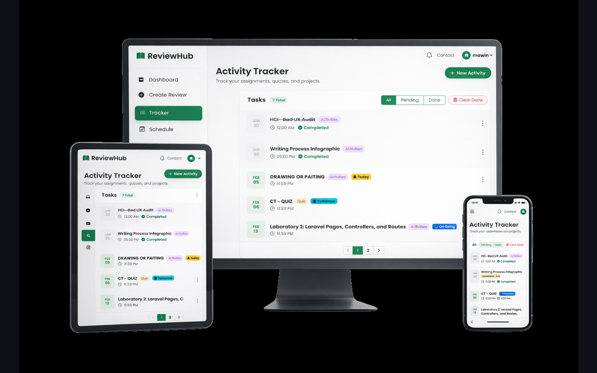
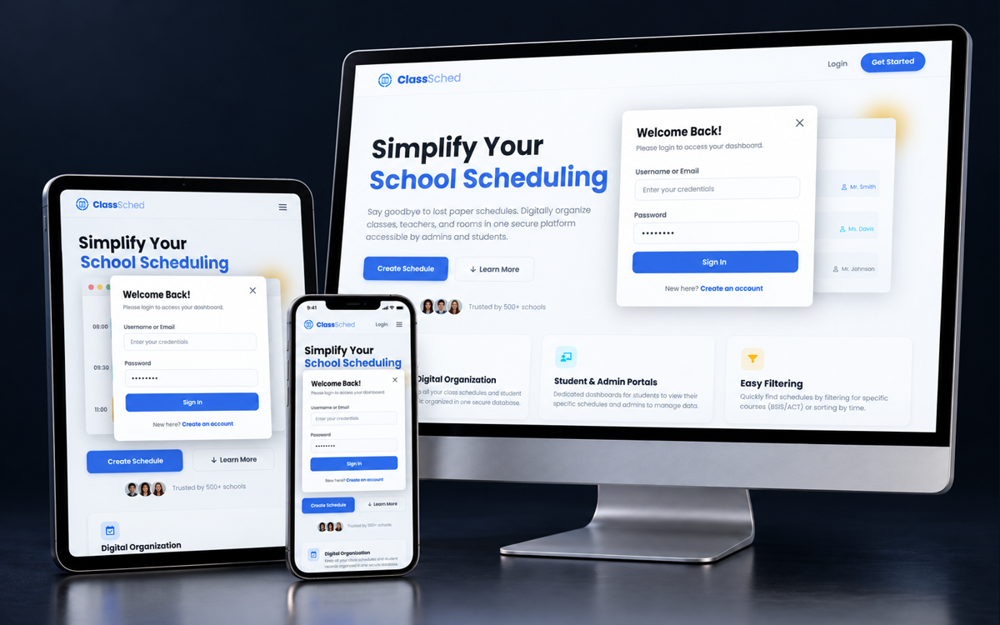
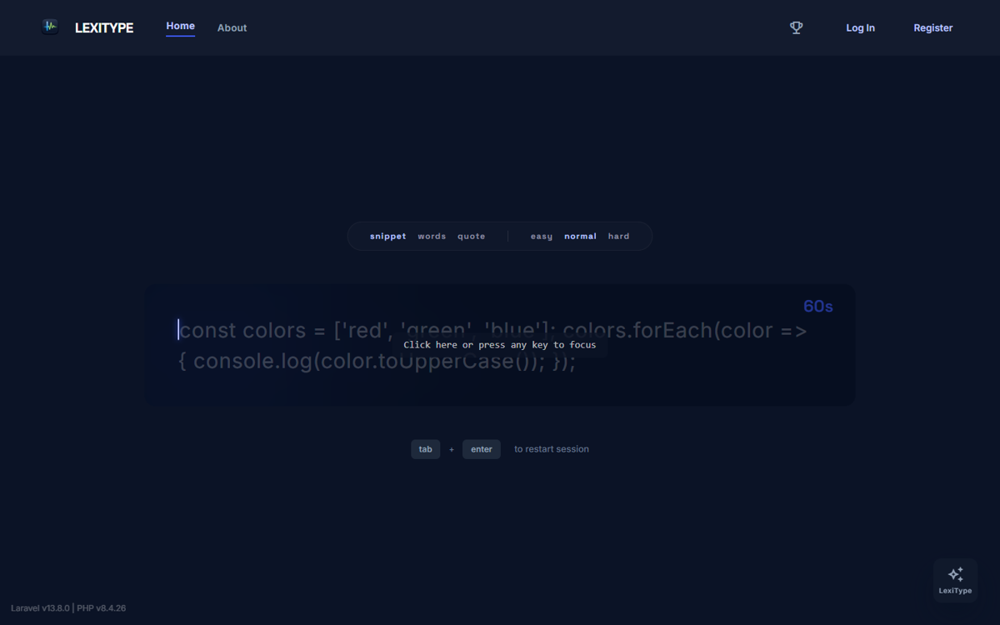
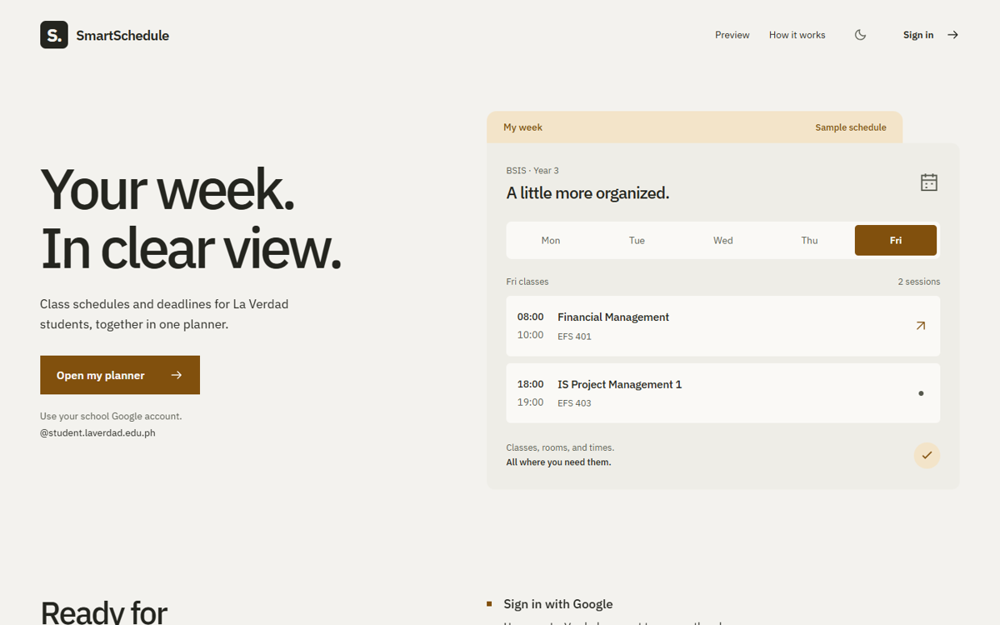
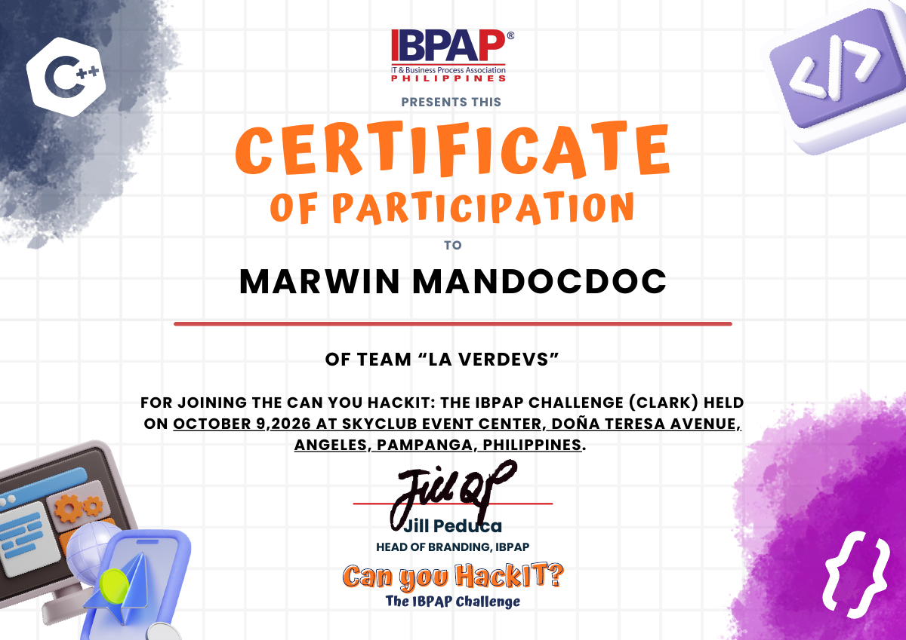

  
  
Aspiring Junior Software Developer | Learning Project Management and Cybersecurity

  

  

 

<h3>About Me</h3>

I am an aspiring junior software developer learning through practical projects. I build web applications with Laravel and React, alongside PHP and SQLite tools and Python command-line applications. I participate in competitions and am developing my knowledge of project management and cybersecurity. I am seeking an entry-level opportunity to learn and contribute to a team.

 

<h3>Tech Stack</h3>

<table align="center">
<tr>
<td width="150" valign="middle"><strong>Languages</strong></td>
<td width="540">

</td>
</tr>
<tr>
<td width="150" valign="middle"><strong>Frontend</strong></td>
<td width="540">

</td>
</tr>
<tr>
<td width="150" valign="middle"><strong>Backend</strong></td>
<td width="540">

</td>
</tr>
<tr>
<td width="150" valign="middle"><strong>Databases</strong></td>
<td width="540">

</td>
</tr>
<tr>
<td width="150" valign="middle"><strong>Tools</strong></td>
<td width="540">

</td>
</tr>
</table>

<strong>Also used in projects</strong>

     

 

<h3>Featured Projects</h3>

<table>
<tr>
<td width="50%" valign="top">

<h3>ReviewHub: Study &amp; Task Tracker</h3>

Organizes review questions, weekly schedules, and student deadlines.

   

 

</td>
<td width="50%" valign="top">

<h3>ClassSched</h3>

A school scheduling app with student profiles and administrator controls.

   

 

</td>
</tr>
<tr>
<td width="50%" valign="top">

<h3><a href="https://lexitype.onrender.com/">LexiType: AI-Powered Typing Trainer</a></h3>

Tracks typing speed and accuracy, with leaderboards and AI coaching.

    

 

</td>
<td width="50%" valign="top">

<h3><a href="https://class-sched.vercel.app/">Smart Class Scheduler</a></h3>

Displays class schedules using Google sign-in and live Google Sheets data.

    

 

</td>
</tr>
</table>

<strong>Explore seven more projects</strong>

| Project | Description | Technologies | Links |
| --- | --- | --- | --- |
| Two Pointers Visualizer | Visualizes a two-pointer search for a pair of numbers with a target sum. | Python, Algorithms, Two Pointers | Demo / source: links unavailable |
| LighTerm: Terminal Bible App | A terminal Bible reader with bookmarks, search history, and custom search algorithms. | Python, Trie & Tree, Hash Table, Deque, Boyer-Moore | Demo / source: links unavailable |
| Cyverdarian CLI | A command-line toolkit with cipher, hash, XOR, and forensics helpers for CTFs. | Bash, Python, CTF, CLI | Demo / source: links unavailable |
| Coffee Supply Management System | Tracks coffee shop inventory with Laravel CRUD workflows. | PHP, Laravel, Bootstrap, CRUD | Live demo: link unavailable · [Source code](https://github.com/mandocdocmawin-dot/mid-term) |
| YouTube Playlist | Manages a YouTube playlist with playback navigation and track details. | React, Vite, CSS, Vercel | [Live demo](https://youtube-features-playlist.vercel.app/) · [Source code](https://github.com/mandocdocmawin-dot/youtube-features-playlist) |
| Hybrid Kanban Board | A student task board with focus limits and deadline planning. | React, Vite, Custom Hooks, Drag & Drop, CSS | [Live demo](https://kanban-lake-five.vercel.app/) · [Source code](https://github.com/mandocdocmawin-dot/kanban-features) |
| TypeTayo: Typing Game | A timed typing game with difficulty levels, keyboard guidance, and accuracy tracking. | React, Vite, Vitest, CSS Modules, State Machine | [Live demo](https://typetayo-gold.vercel.app/) · [Source code](https://github.com/mandocdocmawin-dot/TypeTayo) |

 

<h3>Certifications & Competitions</h3>

| Title | Issuer/Organizer | Year | Result |
| --- | --- | --- | --- |
| [Can You HackIT: The IBPAP Challenge (Clark)](assets/certificates/ibpap-can-you-hackit-2026.pdf)  October 9 · Skyclub Event Center, Angeles, Pampanga | IBPAP (IT &amp; Business Process Association Philippines) | 2026 | Certificate of Participation (Team La VerDevs) |
| [Startup Mentors’ Enablement](assets/certificates/startup-mentors.webp) | DICT · ICT Industry Development Bureau | 2026 | Certificate of completion |
| [Behind the Screen: Game Art Webinar](assets/certificates/game-art.webp) | DICT & Cybercraft PH | 2026 | Certificate of attendance |
| [AGAPAY — Next-Gen Startup Challenge](assets/certificates/agapay.webp) | Info-Systems Next-Gen | 2026 | Participation (AGAPAY team) |
| [9th ICT Week — Capture the Flag](assets/certificates/ict-week.webp) | Association of ICT Majors | 2026 | 🥈 **1st runner-up** (team) |
| [Central Luzon Capture the Flag](assets/certificates/central-luzon.webp) | DICT | 2026 | 🏅 **14th place** (team) |
| [Kyokugen Capture the Flag](assets/certificates/kyokugen-result.webp) [Participation certificate](assets/certificates/kyokugen-participation.webp) | A1SBERG, PUP Santa Maria | 2026 | 🏅 **9th place** (team) |
| [AI Image Content Creation](assets/certificates/ai-image.webp) | International Research Conference on Information Technology Education (IRCITE) | 2026 | 🏆 **Champion** |
| [Micro Short Film](assets/certificates/micro-film.webp) | Regional Assembly on Information Technology Education (RAITE 2026) | 2026 | 🏅 **Social Impact Award** (team) |
| [Men’s Chess — Team](assets/certificates/chess.webp) | LVCC Higher Education | 2026 | 🏆 **Champion** (team) |
| Trend Micro University CTF Certified August 22, 2025 | Trend Micro | 2025 | 62nd place |

 

<h3>GitHub Stats</h3>

  

 

  <h3>Let’s Connect</h3>
  
  
Open to entry-level opportunities and collaborations.

  

  

  

